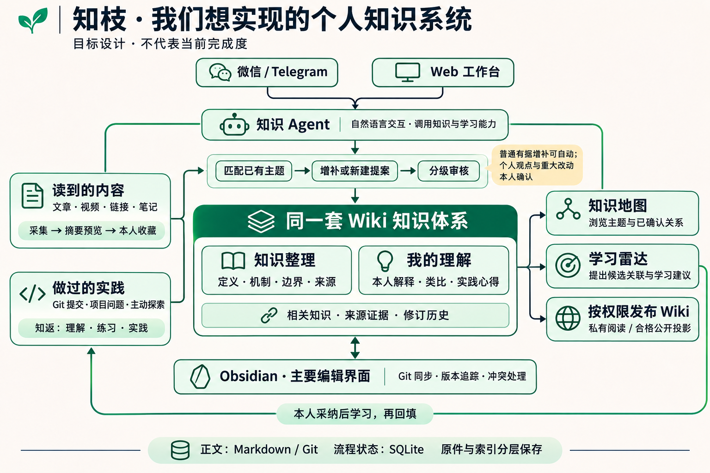
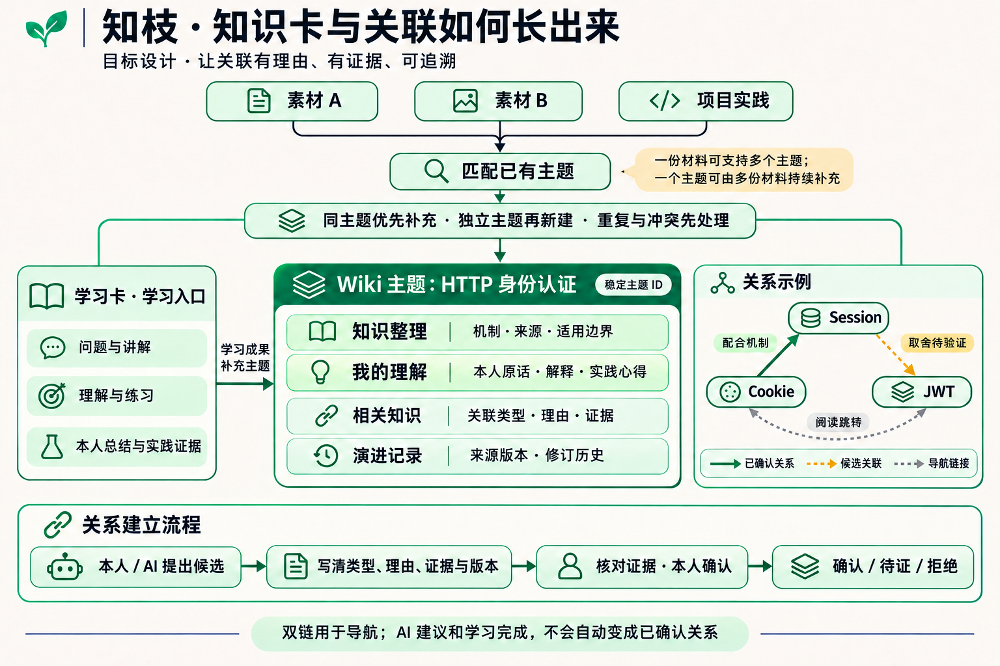
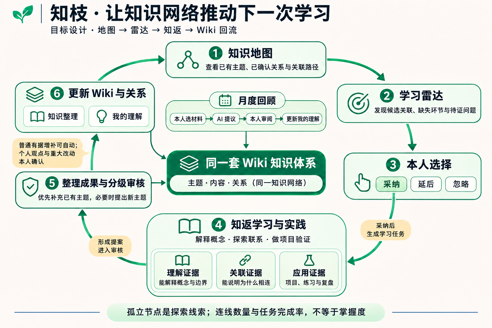

# 产品方向：统一知识资产、知识关联与学习反馈

Status: proposed

本文件描述目标设计，不是代码完成度。依据为用户提供的《个人知识系统统一架构：讨论纪要与设计共识》v0.1（2026-10-19），以及后续已经确认的产品取舍。实现职责另见[当前架构](../../../docs/architecture.md)。

## 已确认的核心方向

1. **最终成果统一到 Wiki**：内容采集与知返学习是两种增长路径，值得长期保留的成果进入同一套知识体系。原件、过程记录和运行状态分别保存。
2. **Obsidian 继续是主编辑界面**：Markdown 保存正文，Git 负责版本与同步；需要补齐同步、冲突检测与合并，保留双方修改。
3. **同主题统一呈现**：知识整理与我的理解在同一主题下阅读，底层可以分开存储，各自保留来源、版本和公开权限。
4. **按风险审核**：普通有依据增补可以自动通过；个人观点、核心结论、重要合并删除与隐私放宽需要本人确认。
5. **知识 Agent 统一交互**：日常使用消息与自然语言，复杂审阅使用 Web 工作台；暂不扩成通用多 Agent 编排中台。
6. **图谱兼具地图与雷达**：既展示已有知识，又提出值得探索的联系与学习线索；结合理解、关联和应用证据形成反馈。

## 学习卡与长期主题

本轮图示先按原方案区分学习入口与长期 Wiki 节点。这是帮助理解产品的概念表达，具体字段、映射基数和关系类型枚举仍需细化。

| 对象 | 职责 | 与其他对象的关系 |
|---|---|---|
| 来源材料 | 保存文章、视频、附件或代码实践的依据与采集范围 | 一份材料可支持多个主题，一个主题也可引用多份材料 |
| 学习卡 | 承载学习问题、讲解、练习和本人总结 | 学习成果匹配并补充已有 Wiki 主题，必要时提出新主题 |
| Wiki 主题 | 用稳定身份组织长期知识 | 汇集知识整理、我的理解、相关知识及来源与演进 |
| 知识关系 | 说明两个主题为什么有关 | 保留关系类型、理由、证据、提出者、状态与对应版本 |

新的来源或学习成果先匹配已有主题：同主题优先增补；确有独立主题时再新建；重复、矛盾或含义不明确时先处理。完成一次学习不强制产生一篇新 Wiki，也不通过重复节点制造知识增长。

## 同一主题的内容结构

- **知识整理**：定义、机制、适用边界、来源依据，区分外部材料和 AI 整理。
- **我的理解**：本人解释、类比、实践心得和后续修正；AI 整理需要真实原话与相应确认。
- **相关知识**：相关主题、关系类型、建立理由、证据和确认状态。
- **来源与演进**：来源版本、学习成果、修订与确认记录。

个人理解可以保留朴素、口语化的表达，无需强行改成百科口吻。知识整理与我的理解统一展示，但不会因共享一个主题就自动共享公开权限。

## 关联如何建立

### 三类关系分别表达

| 类别 | 含义 | 使用边界 |
|---|---|---|
| 导航链接 | 引用、跳转与便于阅读的双链 | 不直接证明语义关系已经成立 |
| 候选关联 | 本人或 AI 提出的联系与待验证假设 | 展示理由、依据与待回答的问题，不混入确认事实 |
| 已确认关系 | 经过核对和确认的知识联系 | 可进入正式知识地图，保留证据与版本，内容变化后仍需核对有效性 |

### 建立过程

1. 本人或 AI 从新材料、已有条目、学习总结与项目实践中提出候选。
2. 写明目标主题、关系类型、建立理由、证据与对应版本。前置概念、配合机制、应用场景、方案对比只是解释用的示例，尚未固定为最终枚举。
3. 对照原文、用户解释与相关实践核对关系；关系确认保留本人审核权。
4. 结果可以是确认、继续待证或拒绝。学习完成、模型置信度和导航双链均不自动产生确认关系。
5. 正式关系与主题一起保留可追溯版本，再更新地图与检索投影。

## 地图、雷达与知返回流

**地图**浏览已有主题、主题簇、已确认关系与关联路径。**雷达**结合正式知识与学习证据，寻找候选关联、缺失的中间机制或条目中的待证问题，并解释推荐理由。

本人可以采纳、延后或忽略建议。采纳只进入学习任务；学习与实践形成成果后，仍经过主题匹配和分级审核，才能补充 Wiki 与正式关系。

三种证据分别保留：

- **理解证据**：能否解释概念、原理和适用边界。
- **关联证据**：能否说明两个知识点为什么相连。
- **应用证据**：是否在项目、练习或其他情境中实际使用和复盘。

孤岛是可供探索的线索，不能直接判定为学习不足；关系数量、页面数量与任务完成率不直接换算成掌握度百分比。

## 月度回顾与个人表达

月度回顾由本人主动选择材料和触发。AI 对照既有主题提出个人理解的补充或修订，提供依据，由本人审阅后再更新同一套 Wiki。此流程不默认自动接入全部私人对话，也不将 AI 推测登记为本人观点。

## 编辑、存储与公开

Obsidian 编辑、知识 Agent 交互、Web 审阅、地图浏览与 Wiki 网站阅读使用同一知识体系。正文、来源原件、工作流账本与索引分别承担自己的职责，索引和展示可以重建。

Git 同步需要对照基准版本检测冲突，保留本地与平台双方修改，并提供明确的比较与合并。不能因文本自动合并成功就推断语义冲突已经消失。

普通有来源增补按规则处理，重大修改和个人观点变化等待本人确认。私有知识与经过公开资格检查的投影分开，来源、个人表达和关系均分别核对公开权限。

## 未采用的方向

以 Web/Agent 取代 Obsidian 主编辑，改变了既有使用方式；所有改动都人工确认，会增加常规维护负担；只用独立笔记链接个人理解，会继续分散主题阅读。这些方向未采用。

## 完成条件

- 同一主题能阅读知识整理、个人理解、来源、关系及其演进。
- 多次学习和多份材料能补充同一主题，重复或冲突不会被静默合并。
- 导航、候选和确认关系清晰区分，能够回看建立理由与证据。
- 雷达建议经本人采纳后进入学习，成果经审核再回填 Wiki 和关系。
- Obsidian 与平台双向编辑可同步，冲突保留双方并可处理。
- 真实用户旅程具有独立证据；设计图、仓库搬迁和测试通过均不替代实现与验收。

图片由内置 imagegen 根据上述构想重绘，原完成度图不再作为本页目标说明；[绘图提示词](../../../docs/assets/vision/prompts.md)随资源保存，便于后续修订。
