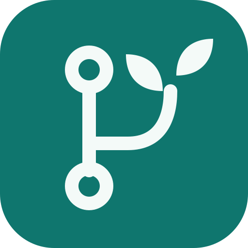
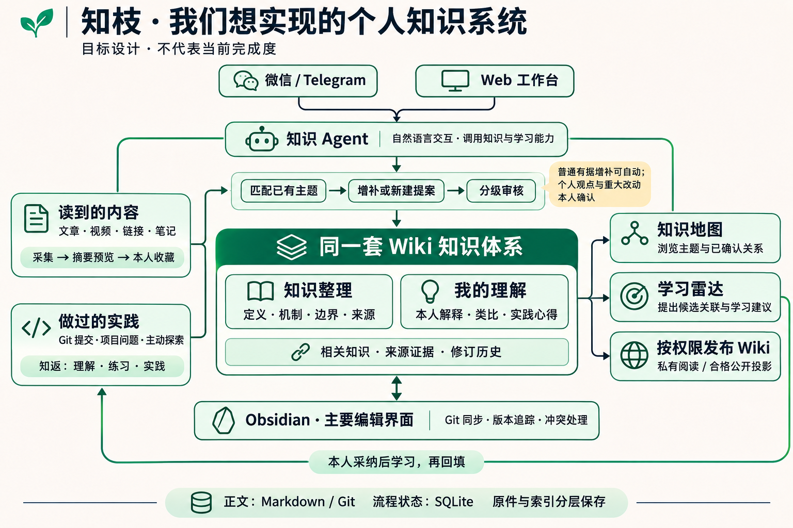
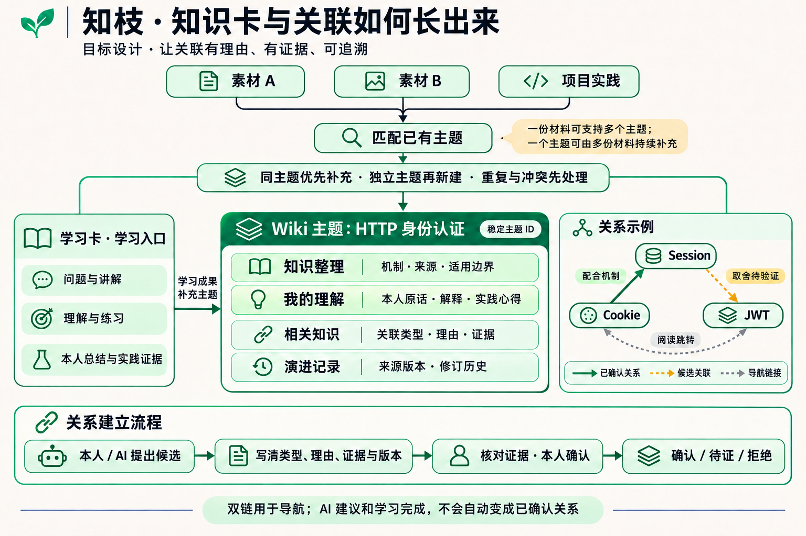
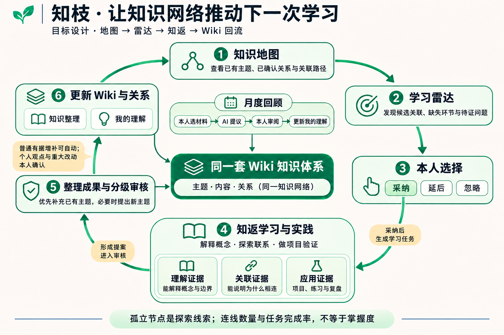

<div align="center">
  
  <h1>知枝 · Zhizhi Next</h1>
  <p><strong>把读过的材料、做过的项目，连成自己的知识网络。</strong></p>
  <p>收集资料，理解与实践，建立知识之间的联系，再持续更新自己的 Wiki。</p>
  <p>
    <a href="https://github.com/sep-zxy/zhizhi-next/actions/workflows/ci.yml"></a>
    <a href="THIRD_PARTY_NOTICES.md">来源与许可证</a>
  </p>
  <p><a href="#目标构想">目标构想</a> · <a href="#知识如何建立联系">知识如何建立联系</a> · <a href="#开始使用与开发">开始使用与开发</a> · <a href="docs/README.md">文档</a> · <a href="https://github.com/sep-zxy/zhizhi-next/issues">问题反馈</a></p>
</div>

## 为什么做知枝

收藏的文章、项目里的踩坑、与 AI 的讨论和自己的笔记，往往分散在不同地方。知枝希望把这些材料连接起来，让每个主题都能保留资料中的知识、自己的理解，以及它与其他知识的关系。

它从原有知枝的工程学习能力继续演进，逐步整合内容采集、Obsidian 编辑、知识 Agent、私有 Wiki 和学习图谱。适合希望从日常阅读与项目实践中持续积累知识的人。

其中，**知识 Agent** 是日常的自然语言入口，**知返**负责学习与实践过程，**Wiki**保存经过整理的长期知识成果。它们围绕同一套个人知识协作。

**项目仍在开发中。下面的设计图描述我们打算实现的产品，不是功能完成度或交付承诺。** 已有基础与待补齐内容见[当前阶段](#当前阶段)。

## 目标构想

日常通过微信、Telegram 或电脑入口向知识 Agent 分享资料、提出问题；复杂的审阅和图谱操作放在 Web 工作台；长期知识在 Obsidian 中编辑，通过 Markdown/Git 保留版本。



| 我想做的事 | 知枝的目标使用方式 |
|---|---|
| 快速判断一份资料是否值得留 | 分享链接或文本，先看摘要、原文依据与采集范围，再决定收藏或丢弃 |
| 从真实项目中学习 | 从 Git 提交、问题和实践中形成学习卡，阅读讲解、完成练习、写下自己的解释 |
| 积累同一个主题 | 新材料和新的学习成果优先补充已有主题，保留来源、适用边界与修订历史 |
| 建立知识之间的联系 | 看清两个知识点为什么有关，关联到具体依据，并区分候选关系与确认关系 |
| 决定接下来学什么 | 用地图查看已有知识，用雷达发现值得探索的缺口，采纳后进入学习任务 |
| 保留并分享自己的知识 | 在 Obsidian 中维护正文；经过独立公开检查的内容可生成只读 Wiki 站点 |

### 同一主题，区分知识整理与我的理解

例如，一个关于 **HTTP 身份认证** 的主题，需要同时容纳：

- **知识整理**：Cookie、Session、JWT 的机制、边界与来源。
- **我的理解**：自己如何解释这些概念、做过什么实践、后来修正了哪些认识。
- **相关知识**：与其他主题的关系、建立关系的理由及其证据。
- **来源与演进**：文章、视频、代码提交、学习成果和历次修改。

两类表达在同一主题中统一呈现，底层可以分开存储，各自保留来源和公开权限。AI 可以帮助整理，个人观点与重要变化需要本人确认。

## 知识如何建立联系

本次图示先区分两类对象：**学习卡**是问题、讲解与练习的入口；**Wiki 主题**是长期沉淀的知识节点。学习成果可以持续补充同一主题，主题之间再建立可追溯的知识关系。

关联需要回答“为什么有关”：是前置概念、配合机制、应用场景，还是值得对比的方案。关系应保留提出者、理由、证据和对应版本。



三类连线分别表达不同含义：

| 关系 | 表达什么 | 如何使用 |
|---|---|---|
| 导航链接 | 两篇内容之间存在引用或跳转 | 帮助查阅，不直接证明知识关系成立 |
| 候选关联 | AI 或本人提出了一个值得验证的联系 | 展示理由、证据和待回答的问题 |
| 已确认关系 | 联系经过核对与确认 | 进入正式知识地图，仍能追溯依据与版本 |

同一份材料可以支持多个主题，一个主题也可以由多份材料和多次学习逐步补充。新内容先匹配已有主题；确有独立主题时再新建节点，重复、矛盾或不确定之处先处理清楚。

### 地图、雷达与学习回流



**地图**用于浏览已有主题、已确认关系和关联路径。**雷达**结合已有知识与学习证据，提出候选关联、待证问题和下一步学习建议。本人采纳后进入学习与实践，成果再补充 Wiki 和关系网络。

理解证据、关联证据、应用证据分别保留。孤立节点可以是探索线索，连线数量和任务完成情况不直接换算成“掌握度”。月度回顾也由本人主动选择材料，再审阅个人理解的更新建议。

完整构想与已确认取舍见[目标设计说明](.agents/notes/proposed/2026-11-16-product-direction.md)。

## 当前阶段

仓库已有材料收件与预览、来源保留、知识提案、分级复核、Git 写入、检索、工程学习、私有 Wiki、Pi 集成和 Quartz 公开投影等基础代码。学习卡、学习成果与正式 Wiki 的接入也在持续整合。

接下来优先补齐：

1. **Obsidian 主编辑闭环**：本地与平台同步、冲突检测、保留双方修改及明确合并。
2. **同主题阅读体验**：把知识整理、个人理解、来源与关联放到同一主题中呈现。
3. **关联与学习反馈**：让候选关系有解释、有验证过程，并把学习成果回填到已有知识。
4. **真实使用与交付**：逐项验证消息渠道、模型账号、桌面安装和公开站点的完整旅程。

设计图中的平台适配、统一知识 Agent、双向同步和完整学习反馈，不能仅凭代码存在视为已经可用。当前技术职责见[实现架构](docs/architecture.md)，验证范围见[测试规则](docs/testing.md)。

## 开始使用与开发

### 获取应用或部署服务

当前新仓库尚未发布正式 Release。维护者或 Fork 仓库可以在 [Build artifacts](https://github.com/sep-zxy/zhizhi-next/actions/workflows/build.yml) 中选择 `desktop`、`backend`、`wiki-private` 等目标，在 GitHub Actions 构建并下载对应产物。

桌面包与源码不附带模型服务或账号额度。使用远程模型、消息渠道或独立知识服务前，需要配置自己的服务与身份；默认不会自动启用模型、渠道或公开发布。

- [使用入口](docs/user/quickstart.md)：应用与产物说明。
- [配置参考](docs/configuration.md)：模型、身份、渠道与桌面配置。
- [桌面宿主](apps/desktop/README.md) / [私有 Wiki](apps/wiki-private/README.md)：各入口的运行方式与限制。

### 阅读源码与参与开发

先按[开发指南](docs/development.md)准备 Git、PowerShell 7、uv 等环境。精确版本由 [toolchains.json](config/toolchains.json) 统一登记。

```powershell
$ErrorActionPreference = 'Stop'
git clone 'https://github.com/sep-zxy/zhizhi-next.git'
Set-Location 'zhizhi-next'
pwsh -NoProfile -File './scripts/dev.ps1' check
```

本地默认只做语法校验；测试、类型检查、构建和打包在 GitHub Actions 执行。真实模型与渠道验收单独触发。

## 项目结构

```text
zhizhi-next/
├── backend/                  # Python 后端、领域服务、工程学习与 API
│   └── src/ahadiff/
│       ├── knowledge_platform/  # 来源、主题、提案、审核、关系和 Git Writer
│       └── growth/              # 既有工程学习、知识卡和本地模式
├── apps/
│   ├── learning-web/          # 学习与练习界面
│   ├── wiki-private/          # 私有知识工作台
│   ├── desktop/               # Electron 桌面宿主
│   └── public-wiki/           # Quartz 只读公开站
├── integrations/pi-zhizhi/    # Pi 工具、本人命令与模型桥
├── optional/                 # 可选工具与插件
├── knowledge-contracts/      # 知识格式、Schema 与模板
├── config/                   # 工具链登记与配置示例
├── docs/                     # 当前使用、架构与开发说明
├── .agents/notes/proposed/    # 目标设计与未落地决定
├── tests/                    # 跨模块与仓库规则检查
└── archive/                  # 历史设计、验收与退役交付材料
```

技术基础为 Python / Starlette、SQLite、Markdown / Git、React / TypeScript / Vite 与 Electron；公开站复用 Quartz。正文、素材、流程状态和索引各有自己的存储职责，正式长期成果统一到 Wiki。

可选组件保留独立安装和运行方式：

| 组件 | 用途 |
|---|---|
| [Vault Manager](optional/vault-manager/README.md) | Obsidian 属性管理与校验 |
| [Continuity Widget](optional/continuity-widget/README.md) | 项目工作区、任务状态与快照 CLI |
| [Obsidian AI Writer](optional/obsidian-ai-writer/README.md) | 独立写作插件；平台双向同步另行建设 |

## 数据、隐私与审核

Markdown/Git 保存正式知识正文与修订历史，SQLite 保存任务和审核等流程状态，原始媒体与附件可以保存在独立的私有对象目录，检索与关系索引可以重建。

普通、有依据的增补可以按规则自动通过；个人观点、核心结论、重要合并删除和隐私范围放宽需要本人确认。公开站只读取通过公开资格检查的内容，原始材料、私人学习过程和个人表达各自保留权限。

接入远程模型或消息服务会涉及相应的数据发送与账号配置。提交 Issue 时，请附上复现步骤和脱敏日志，并先移除凭据、私人知识与工作区数据库。

## 来源与贡献

`zhizhi-next` 在 [zhizhi-platform](https://github.com/sep-zxy/zhizhi-platform) 的 Git 历史上整理，延续 [原知枝](https://github.com/sep-zxy/zhizhi) 的工程学习能力。Python 包与 CLI 仍使用 `ahadiff`，桌面既有数据目录保持兼容，避免仓库重组影响已有工作区。

欢迎提交功能讨论、文档改进和代码修复。贡献前请阅读 [CONTRIBUTING.md](CONTRIBUTING.md) 和 [AGENTS.md](AGENTS.md)。

Python 底座源于 [AhaDiff](https://github.com/AGI-is-going-to-arrive/ahadiff)，保留其 [MIT 许可证与版权](backend/LICENSE)。Quartz、插件、字体及其他组件分别保留自身许可，详见 [THIRD_PARTY_NOTICES.md](THIRD_PARTY_NOTICES.md)。
