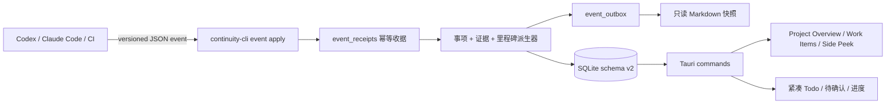

# Continuity Widget 项目进度与工程事件回写 Implementation Plan

> **For Claude:** REQUIRED SUB-SKILL: Use superpowers:executing-plans to implement this plan task-by-task.

**Goal:** 将 Continuity Widget 从“活跃事项提醒器”升级为能清晰管理项目 Todo、待确认事项、里程碑和成熟度，并能由 Codex Skill 在完成已登记工程事项后幂等回写真实进度的本地项目控制台。

**Architecture:** 保留现有 Rust + SQLite + Tauri 2 + 原生 TypeScript 架构，以 SQLite 为唯一实时事实源。后端新增 schema v2、确定性的里程碑进度派生器和幂等工程事件入口；前端采用 clean-room 方式复现 Plane 的项目概览、工作项列表、固定视图、Side Peek 和活动流信息架构，不复制第三方源码、品牌、图标或视觉资产。Codex Skill 负责在明确完成已登记事项后提交结构化事件，Hook 只做遗漏检查、重试和审计，不能凭自然语言模糊判断直接关闭事项。

**Tech Stack:** Rust 2024、rusqlite bundled SQLite、serde/serde_json、chrono、uuid、encoding_rs、Tauri 2、TypeScript 7、Vite 8、Lucide、Vitest、Playwright。

---

## 0. 结论与边界

### 选定路径

采用“增强现有本地应用 + 参考 Plane 信息架构 + Skill 结构化回写”的路径，不 fork Plane、Huly、Linear 类完整项目，也不新增本地 HTTP/WebSocket 服务。

选择依据：

- 本方案承接 `C:\Users\Dell\Desktop\Continuity-Widget-调研报告-2026-07-28.docx` 的候选比较与风险结论。
- 现有应用已经完成 SQLite 单一数据源、Tauri 窗口、CLI、候选项目、事项、证据和 revision 基础，继续演进的迁移成本最低。
- Plane/Huly 的服务端、权限、协作和部署模型远超个人本地工具需要，整体引入会产生第二套事实源和长期维护负担。
- 用户真正缺少的是项目目标、明确的 Todo/待确认分流、可信进度与工程事件回写，不是完整团队协作平台。
- Skill 能在拥有任务上下文时做精确映射；通用 Hook 只看到“工具调用结束”或“回合结束”，不足以安全判断某项工程工作已完成。

### 必须保持的约束

- SQLite 仍是唯一实时数据源；`output/continuity.md` 仍是只读快照。
- `meta.revision` 只代表业务状态变化；窗口移动、窗口尺寸和贴边状态不得增加业务 revision。
- 活跃度用于排序和提醒，不能冒充项目完成进度。
- 项目进度只从已登记里程碑派生；没有里程碑时显示“未规划”，不能显示虚构的 `0%`。
- 只有精确 `itemId` 或 `projectId + fingerprint` 的成功事件可自动完成事项。
- 模糊匹配、人工锁定、已忽略事项和不完整输入只能生成待确认建议。
- `failure`、`cancelled` 事件只追加证据，不能关闭事项。
- project 的 `completed`、`archived` 和成熟度 `mature` 必须由人工或显式、精确的项目事件确认。
- 不保存完整会话正文，只保存事件 ID、结构化结果、短证据和来源引用。
- 不复制 Plane/Linear/Huly 的代码、品牌、文案、图标或资产；仅重现通用交互模式和信息层级。

### 本轮明确不做

- 不做多人、账号、权限、评论、通知中心和云同步。
- 不做自然语言语义匹配自动关单。
- 不接入 GitHub App、Webhook 服务或常驻守护进程。
- 不把 Git commit、测试通过或一次工具调用自动等同于项目完成。
- 不引入 React/Vue；继续使用现有原生 TypeScript，避免无必要重写。

## 0.1 前端设计基准：Plane v1.3.1 Project Workspace

### 唯一参考对象

编辑器前端只以 Plane v1.3.1 的 Project Workspace 为成熟设计基准，不再混用 Linear、Huly、WeekToDo 或其他产品的布局语言。

核对基准：

- 官方版本：[Plane v1.3.1](https://github.com/makeplane/plane/releases/tag/v1.3.1)，发布于 2026-05-14。
- 官方 Work Items / Project Workspace 截图：[github-top.webp](https://media.docs.plane.so/GitHub-readme/github-top.webp)。
- 官方 Views 与筛选条截图：[github-views.webp](https://media.docs.plane.so/GitHub-readme/github-views.webp)。
- 官方 Work Items 能力说明：[makeplane/plane README](https://github.com/makeplane/plane#-features)。
- 官方 Side Peek 实现位置：`apps/web/core/components/issues/peek-overview/`；只参考交互结构，不复制源码。

实施时必须以这些官方页面做并排视觉核对。不得把本方案中的“Plane 式”解释成泛化的 SaaS 三栏后台，也不得自行改成卡片仪表盘。

### Clean-room 复现边界

“照抄”在本项目中的可执行定义是：

- 一致复现信息层级、导航位置、工作区密度、工具栏顺序、列表/看板切换、筛选条和 Side Peek 交互。
- 使用本项目自己的中文文案、数据模型、Lucide 图标、颜色 token 和代码实现。
- 不复制 Plane 的 React 组件、CSS、Logo、项目图标、截图、插画、品牌名称或专有文案。
- 官方截图只作为人工并排验收参考，不提交到项目仓库，也不参与像素 diff 自动化。

### 名词与组件映射

| Plane | Continuity Widget | 处理方式 |
|---|---|---|
| Workspace | 本地工作区 | 固定单工作区，不显示切换器 |
| Project | 项目 | 一一对应 |
| Work item / Issue | 事项 | 一一对应 |
| Modules | 里程碑 | 保留入口和进度语义 |
| Views | 固定视图 | Todo、待确认、阻塞、自动建议、已完成 |
| Issue state | 事项分组 | 按“阻塞 > 待确认 > Todo > 已完成”派生，不新增伪状态 |
| Issue Peek | 事项 Side Peek | 保留右侧详情编辑模式 |
| Activity | 证据与事件活动 | project history、evidence、receipt、suggestion decision |
| Cycles / Pages / Teamspaces | 无对应 | 不显示，不留禁用占位入口 |

### 编辑器桌面骨架

在 `>= 1180px` 宽度下，编辑器必须采用与 Plane Project Workspace 相同的四区骨架：

```text
┌──────┬──────────────────────┬──────────────────────────────────────────────┐
│ 48px │ 240px 项目导航       │ 48px 项目面包屑 / 页面工具栏                │
│ 图标 │ 搜索                 ├──────────────────────────────────────────────┤
│ 导航 │ 项目列表             │ 44px 项目内页导航                           │
│      │                      ├───────────────────────────────┬──────────────┤
│      │ Overview             │ 主内容区                      │ 420px Peek   │
│      │ Work items           │ List / Board / Overview       │ 事项详情      │
│      │ Milestones           │                               │              │
│      │ Activity             │                               │              │
└──────┴──────────────────────┴───────────────────────────────┴──────────────┘
```

固定尺寸：

- 应用图标 rail：48px；只放 `Projects`、全局搜索、设置三个图标，选中态使用 32x32 灰底方形按钮。
- 项目导航 sidebar：240px，可折叠；边界使用 1px 分隔线，不使用浮动卡片。
- 顶部 workspace bar：48px；左侧是 `项目名 > 当前页面`，右侧依次为视图切换、筛选、更多操作。
- 项目内页导航：44px；固定 `概览 / 工作项 / 里程碑 / 活动`，选中项使用 2px 底边，不使用药丸式大按钮。
- Side Peek：桌面 420px，最小 360px，最大为窗口宽度的 42%；打开时压缩主内容，不覆盖列表。
- 内容区水平 padding 16px；列表区域不额外包裹卡片。

### 导航规范

左侧导航必须按 Plane 的“工作区导航 + 当前项目导航”组织：

```text
项目
  搜索项目
  全部项目
  候选项目

当前项目
  概览
  工作项
  里程碑
  活动
```

- 项目列表行高 36px，左侧 8px 项目标识色，项目名只占一行，右侧可显示 open item count。
- 当前项目行使用 `--surface-selected` 背景和左侧 2px accent，不使用整块高饱和背景。
- 候选项目只在“候选项目”入口显示计数，不在每个项目行重复放“待确认”大标签。
- 导航折叠后只保留 48px rail；hover 可临时展开，点击固定展开状态。

### 项目概览规范

概览页不做统计卡片墙，采用 Plane 项目页的“标题头 + 连续内容 band”：

```text
项目名                     [active] [idea] [更多]
一句项目目标
████████████░░░░ 68%       3/5 里程碑
────────────────────────────────────────────
成功标准
多行正文
────────────────────────────────────────────
里程碑
状态  标题                     权重  完成条件
●     Schema v2                20    迁移测试通过
○     Agent event              30    幂等与回滚通过
```

- 项目名 20px/600，目标 13px/400，辅助数据 12px。
- 进度条固定高 6px，宽度不随文字变化；`unplanned` 使用空轨道和“未规划”。
- 成熟度使用小型状态徽标，不能使用大号渐变数字。
- 成功标准和里程碑通过 1px 分隔线组织，不套卡片。
- 里程碑行高 44px；状态、标题、权重、验收标准对齐成列。

### Work Items 页面规范

Work Items 是默认页面，结构必须与 Plane 保持同序：

```text
项目名 > 工作项                      [List][Board] [筛选] [更多]
Todo 12 | 待确认 4 | 阻塞 2 | 建议 1 | 已完成 27
筛选条件: [里程碑: Schema v2 ×] [类型: Todo ×]        [清除]
────────────────────────────────────────────────────────────
状态  标题                         里程碑      优先级  更新
○     修复 revision 语义           Schema v2   高      10:42
?     确认乱码修复清单             Schema v2   高      昨天
!     等待用户批准真实 apply        数据修复    中      昨天
```

#### 顶部工具栏

- 第一行右侧顺序固定为：List/Board segmented icon control、筛选按钮、更多菜单。
- List/Board 使用 Lucide `list`、`columns-3` 图标，28x28；不显示重复文字按钮，hover tooltip 标注名称。
- 筛选按钮打开锚定 popover；筛选项为类型、状态、里程碑、blocking、优先级。
- 第二行是固定视图标签，使用文本 tab + count；不做彩色胶囊导航。
- 第三行只在存在过滤条件时出现，展示可移除 filter chips，高度 36px。

#### List 视图

- 默认视图为 List，表头 32px，事项行高 40px。
- 固定列宽：状态 40px；标题 `minmax(240px, 1fr)`；里程碑 180px；优先级 84px；更新时间 96px。
- 标题单行省略；详情不在主列表展开，点击行进入 Side Peek。
- 行 hover 使用 `--surface-hover`；选中行使用 `--surface-selected` 和左侧 2px accent。
- checkbox/状态图标拥有 28x28 点击区域，视觉图标 16px，避免点击文字误完成。
- `blocking` 在状态图标旁使用红色 `circle-alert`，不能让整行变红。
- 每组为空时只显示一行空态和“新增事项”命令，不显示插画。

#### Board 视图

- 列顺序固定为 `阻塞 / 待确认 / Todo / 已完成`，派生优先级为 blocking open > question open > action open > done。
- 列宽 292px，列间距 12px；列标题高 40px，显示状态图标、名称、数量和新增按钮。
- 卡片最小高 84px，padding 12px，radius 6px，边框 1px；只显示标题、里程碑、优先级和更新时间。
- 不显示负责人头像、日期选择器、标签云等当前领域不存在的信息。
- 卡片点击打开 Side Peek；本轮不做拖拽改变类型，避免把拖列误当成业务状态更新。

### Fixed Views 规范

固定视图复现 Plane Views 的顶部标签与 filter chip 结构，但视图由产品预置，不提供“新建 View”：

- `Todo`：默认进入；绿色/灰色状态图标仅用于事项状态，不给 tab 上色。
- `待确认`：问号图标；显示所有 open question。
- `阻塞`：alert 图标；可同时包含 action 和 question。
- `自动建议`：sparkles 图标；行内提供“应用”和“拒绝”两个图标按钮。
- `已完成`：check-circle 图标；默认按关闭时间倒序。
- tab 文案始终完整显示；宽度不足时进入水平滚动的 tab strip，不压缩到难以识别。

### Side Peek 规范

Side Peek 是唯一事项编辑入口，结构与 Plane issue peek 对齐：

```text
[状态图标] CW-27                         [全屏] [关闭]
事项标题
────────────────────────────────
详情
────────────────────────────────
类型          Todo
里程碑        Schema v2
Blocking      Off
优先级        High
状态          Open
────────────────────────────────
证据与活动
10:42 Codex 完成测试并回写
昨天  用户修改优先级
```

- Peek header 高 48px，关闭和全屏按钮均为 28x28 icon button。
- 标题为 18px/600，可自动换行，不与操作按钮重叠。
- 属性区使用 Plane 风格的 label/value 两列行，每行最小 36px；label 宽 96px。
- 建议的“应用/拒绝”必须在建议条目内完成，不弹出第二层卡片。
- 活动流按时间倒序；来源、摘要、时间三项齐全，payload JSON 默认不显示。
- `Esc` 关闭；关闭前若存在未保存草稿，保留草稿并显示顶部冲突条。

### 视觉 token

使用 4px 基础网格和下列固定 token；实施时所有颜色必须引用 CSS variable，禁止在组件内散落十六进制值：

```css
:root {
  --font-ui: "Inter Variable", "Segoe UI Variable Text", "Microsoft YaHei UI", sans-serif;
  --font-data: "Segoe UI Variable Small", "Microsoft YaHei UI", sans-serif;
  --app-bg: #f7f7f8;
  --surface: #ffffff;
  --surface-hover: #f3f4f6;
  --surface-selected: #eef2f5;
  --border: #e5e7eb;
  --border-strong: #d1d5db;
  --text: #202124;
  --text-muted: #6b7280;
  --text-faint: #9ca3af;
  --accent: #0f6b8d;
  --accent-soft: #e8f3f7;
  --success: #2f9e62;
  --warning: #d08a16;
  --danger: #d14343;
  --question: #7c5cc4;
  --radius-control: 4px;
  --radius-panel: 6px;
  --shadow-popover: 0 8px 24px rgba(32, 33, 36, 0.12);
}
```

排版与间距：

- UI 字体统一 `Inter Variable`，通过 `@fontsource-variable/inter` 本地打包；中文回退到 Microsoft YaHei UI。
- 正文 13px/20px；列表 12px/18px；辅助文字 11px/16px；页面标题 20px/28px。
- 字号不得随 viewport 缩放，letter-spacing 固定 0。
- 间距只使用 4/8/12/16/20/24/32px。
- 面板圆角最大 6px；不使用 pill 作为普通按钮，不使用渐变、发光、bokeh、装饰性大色块。
- 阴影只允许用于 popover、menu、modal；主页面、列表、概览 section 不使用阴影。

### 交互状态

所有可操作元素必须定义：default、hover、active、focus-visible、disabled、loading。

- focus-visible 使用 2px `--accent` 外框，offset 1px。
- mutation 期间只禁用当前控件，不锁死整个页面。
- optimistic revision 冲突使用主内容顶部 36px inline banner，操作为“刷新数据”“保留草稿”；不使用 toast 替代冲突决策。
- 普通保存成功不弹 toast；自动保存状态只在右上角显示“保存中 / 已保存”。
- 删除、忽略、取消里程碑使用确认菜单；完成 Todo 不弹确认框，但支持 event revert/历史恢复。
- loading 使用与目标行等高的 skeleton，避免加载后布局跳动。

### 响应式降级

| 编辑器宽度 | 行为 |
|---|---|
| `>=1180px` | rail 48 + sidebar 240 + main；Side Peek 420px 推挤主区 |
| `900-1179px` | rail 保留，sidebar 折叠为抽屉；Side Peek 360px 推挤主区 |
| `760-899px` | rail 44px，项目导航使用 overlay drawer；主区隐藏低优先级列，只保留状态/标题/里程碑 |
| `<760px` fixture | 单栏；顶部返回按钮；Side Peek 变全屏详情；Board 自动回退 List |

- 当前 Tauri editor 最小宽度 760px，不允许在真实窗口出现横向滚动。
- Side Peek 打开后主列表标题列最小宽度必须保留 240px；不足时自动切换全屏详情。
- Widget 不复制 Plane 的完整导航，只复用同一 token、状态图标、列表行和 progress rail。

### 前端验收矩阵

| Plane 参考特征 | Continuity 验收 |
|---|---|
| 双层左导航 | 48px rail + 240px project sidebar，当前项目下显示四个页面入口 |
| 面包屑顶部栏 | 显示 `项目名 > 当前页面`，操作位次固定 |
| 多布局工具栏 | List/Board segmented icons 在筛选按钮左侧 |
| Views filter chips | 仅有筛选时出现第三行，可逐个移除和全部清除 |
| Work item dense layout | List 行高 40px；Board 列宽 292px、卡片最小 84px |
| Side Peek | 桌面 420px 推挤内容；窄屏全屏；Esc 可关闭 |
| 克制视觉 | 无卡片墙、无渐变、无装饰大图、无 section 阴影 |

Playwright 必须对这些结构使用尺寸与位置断言，不能只检查元素存在。

## 1. 目标状态



### 一级视图

编辑器固定提供以下 Saved Views：

| 视图 | 查询规则 | 默认排序 |
|---|---|---|
| Todo | `kind=action AND status=open` | 阻塞、优先级、里程碑顺序、事项顺序 |
| 待确认 | `kind=question AND status=open` | blocking、优先级、更新时间 |
| 阻塞 | `blocking=true AND status=open` | 项目、优先级、更新时间 |
| 自动建议 | `suggestion.status=pending` | 创建时间倒序 |
| 已完成 | `status=done` | `closed_at` 倒序 |

### 项目成熟度

枚举固定为：

```text
idea -> defined -> executing -> validating -> mature
```

自动推进规则：

- `idea -> defined`：目标、成功标准均非空，且至少存在一个非取消里程碑。
- `defined -> executing`：至少一个里程碑为 `in_progress` 或 `completed`。
- `executing -> validating`：项目进度为 100%，且不存在 unresolved blocking question。
- `validating -> mature`：只能人工确认或应用显式 `project.matured` 事件。
- 默认不自动回退；人工设置后写 `maturity_manual_override=true`，后续自动事件不得覆盖。

### 项目进度

里程碑状态枚举：`planned | in_progress | completed | cancelled`。

```text
progress = completed milestone weight / non-cancelled milestone weight
```

- 权重是 1-100 的整数，默认 1。
- 没有非取消里程碑时 `progressPercent=null`、`progressState="unplanned"`。
- 完成事项后，若该里程碑至少有一个 action、全部 action 为 done，且不存在 open blocking question，则自动将非人工锁定里程碑置为 `completed`。
- 已完成里程碑下新增 open action 时，自动派生器将非人工锁定里程碑恢复为 `in_progress`。
- `dismissed` action 不算完成，也不进入“全部 action 已完成”的有效集合；需要人工决定取消里程碑或补充事项。

## 2. Schema v2

### projects 新增字段

```sql
ALTER TABLE projects ADD COLUMN goal TEXT NOT NULL DEFAULT '';
ALTER TABLE projects ADD COLUMN success_criteria TEXT NOT NULL DEFAULT '';
ALTER TABLE projects ADD COLUMN maturity_stage TEXT NOT NULL DEFAULT 'idea'
  CHECK(maturity_stage IN ('idea','defined','executing','validating','mature'));
ALTER TABLE projects ADD COLUMN maturity_manual_override INTEGER NOT NULL DEFAULT 0;
```

### items 新增字段

```sql
ALTER TABLE items ADD COLUMN milestone_id TEXT REFERENCES project_milestones(id) ON DELETE SET NULL;
ALTER TABLE items ADD COLUMN blocking INTEGER NOT NULL DEFAULT 0;
```

### project_milestones

```sql
CREATE TABLE project_milestones (
  id TEXT PRIMARY KEY,
  project_id TEXT NOT NULL REFERENCES projects(id) ON DELETE CASCADE,
  fingerprint TEXT NOT NULL,
  title TEXT NOT NULL,
  acceptance_criteria TEXT NOT NULL DEFAULT '',
  status TEXT NOT NULL CHECK(status IN ('planned','in_progress','completed','cancelled')),
  weight INTEGER NOT NULL DEFAULT 1 CHECK(weight BETWEEN 1 AND 100),
  manual_override INTEGER NOT NULL DEFAULT 0,
  sort_order INTEGER NOT NULL DEFAULT 0,
  created_at TEXT NOT NULL,
  updated_at TEXT NOT NULL,
  completed_at TEXT,
  revision INTEGER NOT NULL,
  UNIQUE(project_id, fingerprint)
);
```

### suggestions

用通用建议表替换只能绑定 item 的 `item_suggestions`。迁移时通过 `items.project_id` 原样复制现有建议，确认复制数量一致后再删除旧表。

```sql
CREATE TABLE suggestions (
  id TEXT PRIMARY KEY,
  project_id TEXT NOT NULL REFERENCES projects(id) ON DELETE CASCADE,
  item_id TEXT REFERENCES items(id) ON DELETE CASCADE,
  milestone_id TEXT REFERENCES project_milestones(id) ON DELETE CASCADE,
  kind TEXT NOT NULL CHECK(kind IN ('item_patch','completion_candidate','target_resolution','milestone_patch')),
  source TEXT NOT NULL,
  event_id TEXT,
  proposed_json TEXT NOT NULL,
  status TEXT NOT NULL CHECK(status IN ('pending','applied','rejected')),
  created_at TEXT NOT NULL,
  resolved_at TEXT,
  revision INTEGER NOT NULL
);
```

### event_receipts

```sql
CREATE TABLE event_receipts (
  source TEXT NOT NULL,
  event_id TEXT NOT NULL,
  event_type TEXT NOT NULL,
  payload_hash TEXT NOT NULL,
  payload_json TEXT NOT NULL,
  disposition TEXT NOT NULL CHECK(disposition IN ('applied','suggested','evidence_only','reverted')),
  project_id TEXT REFERENCES projects(id) ON DELETE SET NULL,
  item_id TEXT REFERENCES items(id) ON DELETE SET NULL,
  milestone_id TEXT REFERENCES project_milestones(id) ON DELETE SET NULL,
  before_json TEXT NOT NULL,
  result_json TEXT NOT NULL,
  applied_revision INTEGER NOT NULL,
  created_at TEXT NOT NULL,
  reverted_at TEXT,
  PRIMARY KEY(source, event_id)
);
```

### event_outbox

```sql
CREATE TABLE event_outbox (
  id TEXT PRIMARY KEY,
  source TEXT NOT NULL,
  event_id TEXT NOT NULL,
  topic TEXT NOT NULL CHECK(topic IN ('snapshot_export','progress_changed')),
  payload_json TEXT NOT NULL,
  status TEXT NOT NULL CHECK(status IN ('pending','delivered','failed')),
  attempts INTEGER NOT NULL DEFAULT 0,
  next_attempt_at TEXT NOT NULL,
  last_error TEXT,
  created_at TEXT NOT NULL,
  delivered_at TEXT,
  FOREIGN KEY(source, event_id) REFERENCES event_receipts(source, event_id) ON DELETE CASCADE
);
```

## 3. 工程事件合同

### apply 输入

```json
{
  "version": 1,
  "source": "codex-skill",
  "eventId": "01K1EXAMPLESTABLEEVENTID",
  "eventType": "work_item.completed",
  "occurredAt": "2026-07-30T11:30:00+08:00",
  "outcome": "success",
  "project": {
    "id": "project-uuid",
    "path": "C:/Code/rust/continuity-widget"
  },
  "target": {
    "itemId": "item-uuid",
    "fingerprint": "schema-v2-migration"
  },
  "evidence": {
    "sourceRef": "codex:session-id",
    "summary": "schema v2 migration tests and full Rust test suite passed",
    "shortQuote": "test result: ok"
  },
  "expectedRevision": 301
}
```

### apply 结果

```json
{
  "disposition": "applied",
  "receipt": { "source": "codex-skill", "eventId": "01K1EXAMPLESTABLEEVENTID" },
  "item": { "id": "item-uuid", "status": "done" },
  "milestone": { "id": "milestone-uuid", "status": "completed" },
  "projectProgress": { "state": "planned", "percent": 40, "maturityStage": "executing" }
}
```

### 幂等和冲突规则

1. 对 payload 做 RFC 8785 风格的稳定 JSON 序列化后计算 SHA-256；实现中可以使用排序后的 `serde_json::Value`，不得直接 hash 原输入字符串。
2. `(source, event_id)` 不存在：在一个 SQLite immediate transaction 内写 receipt、领域变化和 outbox。
3. `(source, event_id)` 已存在且 hash 相同：返回第一次的 `result_json`，不写 evidence、不写 history、不增加 revision。
4. `(source, event_id)` 已存在但 hash 不同：返回 `event_conflict`，不改变数据库。
5. `target.itemId` 与 `projectId + fingerprint` 同时提供时必须解析到同一事项，否则返回 `target_conflict`。
6. 只提供项目路径或标题时不得自动完成；创建 `target_resolution` suggestion。
7. evidence fingerprint 固定为 `source:eventId`，确保 CLI 重试不会生成重复证据。

### revert 输入

```json
{
  "source": "codex-skill",
  "eventId": "01K1EXAMPLESTABLEEVENTID",
  "expectedRevision": 302
}
```

`event revert` 只恢复该 receipt 在 `before_json` 中记录的字段，不做全库快照覆盖；重复 revert 返回原结果且不增加 revision。

## 4. 实施门禁

当前 `C:\Code\rust\continuity-widget` 不是 Git 仓库，不能满足独立 worktree 和逐任务提交要求。用户审核本方案后，实施第一步必须先建立可追溯基线；在此之前不修改业务代码。

### Task 0: 建立实施基线与数据清单

**Files:**
- Modify: `C:\Code\rust\continuity-widget\.gitignore`
- Reference: `C:\Code\rust\continuity-widget\Cargo.toml`
- Reference: `C:\Code\rust\continuity-widget\package.json`
- Reference: `%LOCALAPPDATA%\Zxy\ContinuityWidget\continuity.db`

**Step 1: 记录当前状态**

```powershell
$ErrorActionPreference = 'Stop'
Set-Location 'C:\Code\rust\continuity-widget'
& '.\bin\continuity-cli.exe' database status
Get-FileHash -Algorithm SHA256 '.\Cargo.lock', '.\package-lock.json'
```

Expected: schema version 为 1；记录 revision、项目、事项、候选数量和两个 lockfile hash。

**Step 2: 补充忽略规则**

在 `.gitignore` 增加 `*.db`、`*.db-shm`、`*.db-wal`、测试截图输出和 Playwright 报告目录，防止真实数据库和运行产物进入版本控制。

**Step 3: 初始化 Git 并建立中文基线提交**

```powershell
$ErrorActionPreference = 'Stop'
Set-Location 'C:\Code\rust\continuity-widget'
rtk git init -b main
rtk git add .
rtk git commit -m 'chore: 建立 Continuity Widget 现状基线'
```

Expected: 工作树干净，`target/`、`bin/`、`dist/`、`node_modules/` 和真实数据库未被跟踪。

**Step 4: 创建实施 worktree**

```powershell
$ErrorActionPreference = 'Stop'
Set-Location 'C:\Code\rust\continuity-widget'
rtk git worktree add 'C:\Users\Dell\.codex\worktrees\continuity-widget-project-progress' -b 'codex/project-progress-events'
```

Expected: 后续 Task 1-13 全部在该 worktree 执行。

### Task 1: 将数据库初始化改为 schema v2 可迁移框架

**Files:**
- Modify: `src/database.rs:8`
- Modify: `src/database.rs:65`
- Create: `tests/database_migration.rs`

**Step 1: 写失败测试**

创建一个只包含 v1 表和 `meta.schema_version=1` 的临时数据库，断言 `Database::open` 后：

```rust
assert_eq!(database.schema_version().unwrap(), 2);
assert!(column_exists(&connection, "projects", "goal"));
assert!(column_exists(&connection, "items", "milestone_id"));
assert!(table_exists(&connection, "project_milestones"));
assert!(table_exists(&connection, "event_receipts"));
assert!(table_exists(&connection, "event_outbox"));
```

再写四项测试：空库直接初始化 v2、重复打开不重复迁移、迁移失败时 schema version 和业务表全部回滚、已有 v1 文件迁移前自动生成可通过 `PRAGMA integrity_check` 的 SQLite backup。

**Step 2: 运行并确认失败**

Run: `rtk cargo test --test database_migration -- --nocapture`

Expected: FAIL，schema version 仍为 1，新增列/表不存在。

**Step 3: 最小实现**

- 将 `SCHEMA_VERSION` 改为 2。
- `initialize` 只负责 meta/bootstrap；按当前版本顺序调用 `migrate_v1_to_v2`。
- 检测到已有 v1 文件时，必须在执行迁移 SQL 前使用 SQLite backup API 写入 `migration-backups/continuity-v1-<timestamp>.db`；新建空库不生成迁移备份。
- 整个版本迁移必须处于单一 immediate transaction。
- 迁移 `item_suggestions -> suggestions` 时先复制并核对 `COUNT(*)`，数量不一致立即回滚。
- 创建本方案第 2 节中的列、表、外键和查询索引。
- 只有所有 SQL 成功后更新 `meta.schema_version=2`。

**Step 4: 运行通过测试**

Run: `rtk cargo test --test database_migration -- --nocapture`

Expected: PASS，重复打开不产生额外业务 revision。

**Step 5: 提交**

```powershell
$ErrorActionPreference = 'Stop'
rtk git add 'src/database.rs' 'tests/database_migration.rs'
rtk git commit -m 'feat: 增加数据库 v2 迁移框架'
```

### Task 2: 增加中文乱码 dry-run 修复

**Files:**
- Modify: `Cargo.toml`
- Create: `src/repair.rs`
- Modify: `src/lib.rs`
- Modify: `src/models.rs`
- Modify: `src/service.rs`
- Modify: `src/bin/continuity-cli.rs`
- Create: `tests/fixtures/legacy-encoding/continuity.md`
- Create: `tests/encoding_repair.rs`

**Step 1: 固化测试样例**

测试必须覆盖：

- 通过 `legacy_id + fingerprint` 恢复项目名、事项标题和 evidence summary。
- 仅当当前值等于“正确 UTF-8 文本按错误 GBK 路径解码后的可复现乱码”时允许修复。
- `manual_override=true`、无法唯一匹配或当前值已被人工改写时只报告 `skipped`。
- dry-run 不写数据库、不增加 revision、不创建备份。
- apply 前调用 SQLite backup API；修复成功只增加一次 revision。

**Step 2: 运行并确认失败**

Run: `rtk cargo test --test encoding_repair -- --nocapture`

Expected: FAIL，`repair` 模块和 CLI 命令不存在。

**Step 3: 实现匹配与修复**

- 添加 `encoding_rs` 依赖，不在前端做转码。
- 从用户传入的正常 `output/continuity.md` 或 `legacy-import-backup/<timestamp>/continuity.md` 解析 canonical 文本。
- 输入合同：

```json
{
  "sourcePath": "C:/Code/notes/zxy/output/continuity.md",
  "apply": false,
  "expectedRevision": 297
}
```

- 输出 `matched`、`repairable`、`skipped`、`changes[]`、`backupPath`。
- apply 时先 `backup_database`，再用一个业务事务更新所有确认项。

**Step 4: 验证 dry-run 和 apply**

Run: `rtk cargo test --test encoding_repair -- --nocapture`

Expected: PASS。

真实数据只执行 dry-run并保存结果，用户确认变更清单后才允许 apply：

```powershell
$ErrorActionPreference = 'Stop'
$status = & '.\bin\continuity-cli.exe' database status | ConvertFrom-Json
$request = @{ sourcePath = 'C:/Code/notes/zxy/output/continuity.md'; apply = $false; expectedRevision = $status.revision } | ConvertTo-Json -Compress
$request | & '.\bin\continuity-cli.exe' database repair-legacy-encoding --input -
```

**Step 5: 提交**

```powershell
$ErrorActionPreference = 'Stop'
rtk git add 'Cargo.toml' 'Cargo.lock' 'src/repair.rs' 'src/lib.rs' 'src/models.rs' 'src/service.rs' 'src/bin/continuity-cli.rs' 'tests/fixtures/legacy-encoding/continuity.md' 'tests/encoding_repair.rs'
rtk git commit -m 'fix: 增加旧数据中文乱码安全修复'
```

### Task 3: 分离业务 revision 与窗口状态

**Files:**
- Modify: `src/database.rs:202`
- Modify: `src/service.rs:690`
- Modify: `src-tauri/src/lib.rs`
- Create: `tests/revision_semantics.rs`

**Step 1: 写失败测试**

```rust
let before = service.revision().unwrap();
service.save_window_state(sample_window()).unwrap();
assert_eq!(service.revision().unwrap(), before);

let changed = service.save_project(sample_patch(before)).unwrap();
assert_eq!(changed.revision, before + 1);
```

同时断言相同窗口状态重复保存幂等，不引入 `ui_revision`。

**Step 2: 运行并确认失败**

Run: `rtk cargo test --test revision_semantics -- --nocapture`

Expected: FAIL，窗口首次保存会令 revision +1。

**Step 3: 最小实现**

- 新增 `Database::with_transaction_without_revision`。
- `save_window_state` 使用非业务事务并返回 `Result<()>`。
- Tauri `save_current_window_state` 不 emit revision。
- 业务 mutation 继续使用现有 optimistic revision。

**Step 4: 验证并提交**

Run: `rtk cargo test --test revision_semantics -- --nocapture`

Expected: PASS。

```powershell
$ErrorActionPreference = 'Stop'
rtk git add 'src/database.rs' 'src/service.rs' 'src-tauri/src/lib.rs' 'tests/revision_semantics.rs'
rtk git commit -m 'fix: 将窗口状态移出业务 revision'
```

### Task 4: 实现里程碑、成熟度和进度派生器

**Files:**
- Modify: `src/models.rs:45`
- Modify: `src/models.rs:60`
- Create: `src/progress.rs`
- Modify: `src/lib.rs`
- Modify: `src/service.rs:156`
- Create: `tests/project_progress.rs`

**Step 1: 写领域测试**

覆盖以下表驱动用例：

```rust
#[test]
fn derives_weighted_progress() {
    assert_eq!(progress_of(&[]), (None, ProgressState::Unplanned));
    assert_eq!(
        progress_of(&[(MilestoneStatus::Completed, 2), (MilestoneStatus::Planned, 3)]),
        (Some(40), ProgressState::Planned),
    );
    assert_eq!(
        progress_of(&[(MilestoneStatus::Completed, 2), (MilestoneStatus::Cancelled, 8)]),
        (Some(100), ProgressState::Planned),
    );
}
```

另写测试：全部 action 完成自动关闭里程碑、blocking question 阻止关闭、新增 open action 重新打开非人工里程碑、人工里程碑不被派生器改写、成熟度只单向自动推进、`mature` 必须显式确认。

**Step 2: 运行并确认失败**

Run: `rtk cargo test --test project_progress -- --nocapture`

Expected: FAIL，模型和 `progress` 模块不存在。

**Step 3: 增加模型**

- `Project` 增加 goal/successCriteria/maturityStage/maturityManualOverride。
- `Item` 增加 milestoneId/blocking。
- 新增 `ProjectMilestone`、`ProjectProgress`、`MilestoneInput`、`MilestonePatchInput`。
- `ProjectView` 返回 `milestones` 和 `progress`；前端不自行计算百分比。

**Step 4: 实现纯派生函数和 service mutation**

- `derive_progress(milestones) -> ProjectProgress` 必须是无 IO 纯函数。
- `reconcile_milestones(transaction, project_id, revision)` 在 item/milestone mutation 后执行。
- `derive_maturity` 只能自动向前，遇到 `maturity_manual_override` 直接保留。
- 新增 milestone upsert/save/complete/cancel service 方法。

**Step 5: 验证并提交**

Run: `rtk cargo test --test project_progress -- --nocapture`

Expected: PASS。

```powershell
$ErrorActionPreference = 'Stop'
rtk git add 'src/models.rs' 'src/progress.rs' 'src/lib.rs' 'src/service.rs' 'tests/project_progress.rs'
rtk git commit -m 'feat: 增加里程碑与项目成熟度派生'
```

### Task 5: 实现幂等 event apply

**Files:**
- Modify: `Cargo.toml`
- Create: `src/events.rs`
- Modify: `src/lib.rs`
- Modify: `src/models.rs`
- Modify: `src/service.rs`
- Modify: `src/bin/continuity-cli.rs:46`
- Create: `tests/event_apply.rs`
- Create: `tests/fixtures/event-completed.json`

**Step 1: 写失败测试**

至少覆盖：

- 精确 success 事件完成 open action、追加一条 evidence、重算里程碑和项目进度，只增加一次 revision。
- 同 source/eventId/hash 重放返回相同 result，不增加 revision。
- 同 source/eventId 不同 payload 返回 `event_conflict`。
- itemId 与 fingerprint 指向不同事项返回 `target_conflict`。
- failure/cancelled 只追加 evidence。
- question、dismissed 或 manual_override 生成 suggestion，不自动 done。
- 只有 path/title 的模糊目标生成 `target_resolution` suggestion。

**Step 2: 运行并确认失败**

Run: `rtk cargo test --test event_apply -- --nocapture`

Expected: FAIL，事件 DTO 和 `ContinuityService::apply_event` 不存在。

**Step 3: 实现稳定 hash 和事件事务**

- 添加 `sha2` 依赖。
- 对 object key 递归排序后序列化并计算 SHA-256。
- 先在只读连接查询 receipt；真正插入时仍依赖主键处理并发竞争。
- receipt、事项变化、evidence、suggestion、里程碑派生、project history 和 outbox 必须在同一业务事务提交。
- CLI 增加 `event apply --input -`，错误代码增加 `event_conflict`、`target_conflict`。

**Step 4: 验证 CLI 合同**

```powershell
$ErrorActionPreference = 'Stop'
rtk cargo test --test event_apply -- --nocapture
rtk cargo build --bin continuity-cli
$payload = Get-Content -Raw -Encoding UTF8 '.\tests\fixtures\event-completed.json'
$payload | & '.\target\debug\continuity-cli.exe' event apply --input -
```

Expected: 第一次 `disposition=applied`；第二次 `disposition=applied` 且 revision 不变，结果内容相同。

**Step 5: 提交**

```powershell
$ErrorActionPreference = 'Stop'
rtk git add 'Cargo.toml' 'Cargo.lock' 'src/events.rs' 'src/lib.rs' 'src/models.rs' 'src/service.rs' 'src/bin/continuity-cli.rs' 'tests/event_apply.rs' 'tests/fixtures/event-completed.json'
rtk git commit -m 'feat: 增加幂等工程事件回写'
```

### Task 6: 实现 outbox、重试和 event revert

**Files:**
- Modify: `src/events.rs`
- Modify: `src/snapshot.rs:9`
- Modify: `src/service.rs`
- Modify: `src/bin/continuity-cli.rs`
- Create: `tests/event_recovery.rs`

**Step 1: 写失败测试**

- 领域事务成功时同时产生 `snapshot_export` 和进度变化时的 `progress_changed` outbox。
- snapshot 首次写入失败时 outbox 变为 failed，保存 last_error 和下一次重试时间。
- `event retry-pending` 成功后置 delivered，不增加业务 revision。
- revert 精确恢复 item/milestone 前值并重新派生项目进度。
- revert 重放不增加 revision；不存在或已被后续冲突修改时返回可解释错误。

**Step 2: 运行并确认失败**

Run: `rtk cargo test --test event_recovery -- --nocapture`

Expected: FAIL，outbox drain 和 revert 尚未实现。

**Step 3: 最小实现**

- `event apply` 提交后尝试 drain 当前 receipt 的 outbox；失败不回滚已提交领域数据，但 CLI 在 warnings 返回待重试状态。
- `event retry-pending` 处理 `pending|failed` 且到期的记录，采用 1m/5m/30m 最大三档退避。
- `event revert` 使用 receipt.before_json 做字段级恢复，不能复用 `undo_last_automatic` 的全库覆盖。
- outbox 状态变化使用非业务事务；领域 revert 使用业务事务。

**Step 4: 验证并提交**

Run: `rtk cargo test --test event_recovery -- --nocapture`

Expected: PASS。

```powershell
$ErrorActionPreference = 'Stop'
rtk git add 'src/events.rs' 'src/snapshot.rs' 'src/service.rs' 'src/bin/continuity-cli.rs' 'tests/event_recovery.rs'
rtk git commit -m 'feat: 增加事件重试与字段级回滚'
```

### Task 7: 完成建议决策与 CLI 查询面

**Files:**
- Modify: `src/models.rs`
- Modify: `src/service.rs`
- Modify: `src/bin/continuity-cli.rs`
- Create: `tests/query_and_suggestions.rs`

**Step 1: 写失败测试**

测试 `item list`、`project progress`、`event status` 的稳定排序和 JSON 合同；测试 suggestion apply/reject 幂等、expectedRevision 冲突和 applied 后领域派生。

**Step 2: 运行并确认失败**

Run: `rtk cargo test --test query_and_suggestions -- --nocapture`

Expected: FAIL，命令不存在。

**Step 3: 实现以下 CLI**

```text
continuity-cli item list --project <uuid>
continuity-cli project progress --input -
continuity-cli event status --input -
continuity-cli suggestion apply --input -
continuity-cli suggestion reject --input -
```

其中 `item list` 允许 `--project` 作为唯一非 JSON 查询参数；所有 mutation 仍使用 JSON 输入。

**Step 4: 验证并提交**

Run: `rtk cargo test --test query_and_suggestions -- --nocapture`

Expected: PASS。

```powershell
$ErrorActionPreference = 'Stop'
rtk git add 'src/models.rs' 'src/service.rs' 'src/bin/continuity-cli.rs' 'tests/query_and_suggestions.rs'
rtk git commit -m 'feat: 补全进度查询与建议决策命令'
```

### Task 8: 扩展快照与 Tauri 命令

**Files:**
- Modify: `src/snapshot.rs:9`
- Modify: `src-tauri/src/lib.rs:1`
- Modify: `ui/src/types.ts`
- Modify: `ui/src/api.ts`
- Create: `tests/snapshot_progress.rs`

**Step 1: 写失败测试**

快照断言包含项目目标、成功标准、成熟度、进度、里程碑、Todo、待确认、阻塞、建议计数和 evidence；相同业务 revision 仍不得重写。

**Step 2: 运行并确认失败**

Run: `rtk cargo test --test snapshot_progress -- --nocapture`

Expected: FAIL，当前快照没有进度字段。

**Step 3: 扩展 Rust/Tauri/TypeScript 合同**

- Tauri 新增 milestone mutation、suggestion decision 和 project activity 查询 command。
- `DashboardView` 返回项目进度摘要、open Todo 数、open question 数、blocking 数、pending suggestion 数。
- `EditorView` 返回后端生成的 Saved Views 数据或满足固定查询所需的完整结构。
- `types.ts` 与 Rust camelCase DTO 一一对应，不使用 `unknown` 隐藏核心字段。

**Step 4: 验证合同**

Run: `rtk cargo test --test snapshot_progress -- --nocapture`

Run: `rtk npm run build`

Expected: Rust 测试和 TypeScript 编译全部通过。

**Step 5: 提交**

```powershell
$ErrorActionPreference = 'Stop'
rtk git add 'src/snapshot.rs' 'src-tauri/src/lib.rs' 'ui/src/types.ts' 'ui/src/api.ts' 'tests/snapshot_progress.rs'
rtk git commit -m 'feat: 向快照和桌面接口暴露项目进度'
```

### Task 9: 按 Plane 信息架构重做编辑器

**Files:**
- Modify: `package.json`
- Modify: `package-lock.json`
- Create: `ui/src/design-tokens.css`
- Modify: `ui/src/editor.ts`
- Create: `ui/src/editor-state.ts`
- Modify: `ui/src/styles.css`
- Create: `ui/src/editor-state.test.ts`
- Create: `tests/ui/editor.spec.ts`
- Create: `tests/ui/fixtures/editor-view.json`

**Step 1: 建立可测试状态层**

将筛选、选择、Saved View 查询、Side Peek 开关和草稿保护从 DOM 渲染中提取到 `editor-state.ts`。写 Vitest 测试：

- Todo/待确认/阻塞/建议/已完成互斥且计数正确。
- Board 分组严格按 `blocking open > question open > action open > done` 派生，同一事项只进入一列。
- 项目切换后保留有效 tab，清理失效 item selection。
- revision conflict 保留未提交草稿。
- URL/query state 或内存 state 可稳定恢复 Side Peek。

**Step 2: 运行并确认失败**

Run: `rtk npm test -- --run ui/src/editor-state.test.ts`

Expected: FAIL，测试脚本和状态模块不存在。

**Step 3: 实现编辑器布局**

严格按第 0.1 节实现，不允许自行改版：

- 安装并本地打包 `@fontsource-variable/inter`，创建 `design-tokens.css`，所有编辑器颜色、圆角、阴影和字体只引用规定 token。
- 实现 48px icon rail、240px project sidebar、48px breadcrumb bar、44px project nav。
- 项目导航固定为概览、工作项、里程碑、活动，不显示当前产品没有的数据入口。
- Work Items 第一行右侧固定为 List/Board、筛选、更多；第二行固定视图；第三行按需显示 filter chips。
- List 固定 40px 行高和列宽规则；Board 固定 292px 列宽、12px gap、84px 卡片最小高度。
- 点击事项打开 420px Side Peek，属性使用 96px label/value 行；窄屏按规范切换 360px 或全屏详情。
- Overview、Milestones、Activity 使用连续 band 和分隔线，不做统计卡片墙。
- Activity 统一展示 project history、event receipt 和 suggestion decision，不展示完整 payload 正文。
- 保留现有 500ms 自动保存；revision 冲突改为 36px inline banner，不能只显示 toast。

**Step 4: 增加 fixture 模式和 Playwright 验收**

- `?fixture=editor` 时从 fixture 加载只读 DTO，禁止调用 Tauri mutation，供浏览器截图和布局测试。
- Playwright 验证 1440x900、1024x768、760x640、390x844。
- 对 rail/sidebar/topbar/project-nav/Side Peek 做 `boundingBox` 尺寸断言，误差不超过 1px。
- 对 List 行高、Board 列宽和卡片最小高度做尺寸断言。
- 验证工具栏顺序、固定视图顺序、filter chips 出现条件、Side Peek 推挤/全屏降级。
- 验证无横向溢出、按钮文本不截断、最长中文标题不遮挡图标、键盘焦点可见。
- 人工将 1440x900 的 Overview、List、Board、Side Peek 四张截图与第 0.1 节官方参考并排审查；只比较结构、密度和交互层级，不复制品牌细节。

**Step 5: 运行测试和构建**

```powershell
$ErrorActionPreference = 'Stop'
rtk npm test -- --run
rtk npx playwright test 'tests/ui/editor.spec.ts'
rtk npm run build
```

Expected: 全部 PASS，截图保存到忽略目录 `test-results/`。

**Step 6: 提交**

```powershell
$ErrorActionPreference = 'Stop'
rtk git add 'package.json' 'package-lock.json' 'ui/src/design-tokens.css' 'ui/src/editor.ts' 'ui/src/editor-state.ts' 'ui/src/styles.css' 'ui/src/editor-state.test.ts' 'tests/ui/editor.spec.ts' 'tests/ui/fixtures/editor-view.json'
rtk git commit -m 'feat: 重做 Plane 式项目编辑器'
```

### Task 10: 重做紧凑 Widget 与伴随预览

**Files:**
- Modify: `ui/src/widget.ts`
- Modify: `ui/src/preview.ts`
- Modify: `ui/src/styles.css`
- Create: `ui/src/widget-state.ts`
- Create: `ui/src/widget-state.test.ts`
- Create: `tests/ui/widget.spec.ts`
- Create: `tests/ui/fixtures/dashboard-view.json`

**Step 1: 写失败测试**

测试 Widget 的稳定容量、进度格式和项目切换：

- 无里程碑显示“未规划”，不能显示 `0%`。
- Todo、待确认和阻塞计数分别显示。
- “现在做”只包含 open action；question 不能出现在完成按钮列表。
- 完成一项后按后端新结果补位，布局高度不跳变。

**Step 2: 运行并确认失败**

Run: `rtk npm test -- --run ui/src/widget-state.test.ts`

Expected: FAIL，当前 Widget 仍以活跃度为主要项目反馈。

**Step 3: 实现 Widget**

- 导入 `design-tokens.css`，复用 Plane 基准中的字体、颜色、状态图标、40px 列表行和 6px progress rail，不单独发明另一套 Widget 视觉。
- 顶部使用与 Project Workspace 相同的 breadcrumb 密度：当前项目名、成熟度、进度文本和 28px 操作图标。
- 主区分为“现在做”和“待确认”，事项行沿用 Work Items List 的状态/标题结构；阻塞只标记状态图标，不让整行变红。
- 底部使用项目切换与 `Todo / 待确认 / 里程碑` 三个计数，不再重复展开“每日确认/本周方向”。
- 伴随预览使用与 Side Peek 相同的 header、属性行和活动样式，内容改为项目 Overview：目标、成功标准、当前里程碑、下一 Todo、blocking question。
- 保留窗口贴边、分页、无滚动、托盘和快速添加。

**Step 4: 浏览器布局验收**

Playwright 在 450x720、420x560、520x900 检查：无重叠、无水平滚动、最长中文项目名换行或省略合理、操作按钮保持 28px、事项行保持 40px、progress rail 保持 6px，视觉 token 与编辑器一致。

**Step 5: 验证并提交**

```powershell
$ErrorActionPreference = 'Stop'
rtk npm test -- --run
rtk npx playwright test 'tests/ui/widget.spec.ts'
rtk npm run build
rtk git add 'ui/src/widget.ts' 'ui/src/preview.ts' 'ui/src/styles.css' 'ui/src/widget-state.ts' 'ui/src/widget-state.test.ts' 'tests/ui/widget.spec.ts' 'tests/ui/fixtures/dashboard-view.json'
rtk git commit -m 'feat: 重做项目进度桌面组件'
```

### Task 11: 创建 Codex 项目进度 Skill

**Files:**
- Create: `C:\Users\Dell\.codex\skills\continuity-update-progress\SKILL.md`
- Create: `C:\Users\Dell\.codex\skills\continuity-update-progress\agents\openai.yaml`
- Create: `C:\Users\Dell\.codex\skills\continuity-update-progress\references\event-contract.md`
- Create: `C:\Code\codex\dev-tools\continuity-event.ps1`
- Modify: `C:\Code\codex\dev-tools\continuity-widget.md`
- Modify: `C:\Code\codex\dev-tools\dev-tools.md`
- Create: `tests/skills/continuity-update-progress.Tests.ps1`

**Step 1: 先写 PowerShell 包装测试**

纯 PowerShell 测试必须使用临时数据库/fixture CLI，覆盖：有效 JSON 透传、非零退出码透传、stdout 保持 JSON、重复 eventId 幂等、未提供精确目标时拒绝自动完成。

**Step 2: 运行并确认失败**

```powershell
$ErrorActionPreference = 'Stop'
& '.\tests\skills\continuity-update-progress.Tests.ps1'
```

Expected: FAIL，包装脚本和 Skill 不存在。

**Step 3: 用 skill-creator 初始化**

```powershell
$ErrorActionPreference = 'Stop'
$creator = 'C:\Users\Dell\.codex\skills\.system\skill-creator\scripts\init_skill.py'
uv run python $creator 'continuity-update-progress' --path 'C:\Users\Dell\.codex\skills' --resources references --interface 'display_name=更新 Continuity 项目进度' --interface 'short_description=完成已登记工程事项后安全回写进度' --interface 'default_prompt=核对已登记事项并提交幂等完成事件。'
```

Expected: 生成合法 SKILL.md 和 `agents/openai.yaml`，没有示例占位文件。

**Step 4: 编写低自由度工作流**

SKILL.md 必须要求：

1. 在开始工程任务时运行 `item list --project`，记录明确 itemId/fingerprint 和开始 revision。
2. 只有实现、必要测试和用户要求的构建均成功后，才构造 `work_item.completed + success`。
3. 测试失败或取消时提交 `failure/cancelled` evidence，不关闭事项。
4. 无精确登记项时不猜测；提示登记或提交 target-resolution suggestion。
5. 使用一次生成后不变的 eventId 重试；不得在重试时生成新 ID。
6. 调用 `C:\Code\codex\dev-tools\continuity-event.ps1`，不直接拼接易错 PowerShell JSON。
7. 回写后读取 event status/project progress，并把 disposition、revision、progress 告知用户。

详细 JSON 合同放入 `references/event-contract.md`，SKILL.md 保持简短。

**Step 5: 验证 Skill 和包装脚本**

```powershell
$ErrorActionPreference = 'Stop'
$validator = 'C:\Users\Dell\.codex\skills\.system\skill-creator\scripts\quick_validate.py'
uv run python $validator 'C:\Users\Dell\.codex\skills\continuity-update-progress'
& '.\tests\skills\continuity-update-progress.Tests.ps1'
```

Expected: skill validation 和包装测试 PASS。

**Step 6: 同步全局工具文档并提交项目内测试**

`continuity-event.ps1` 作为全局自制包装工具登记到 `dev-tools.md`，完整参数和示例写入 `continuity-widget.md`。项目提交只包含项目内测试；全局 Skill/工具文件在最终变更清单单独列出。

```powershell
$ErrorActionPreference = 'Stop'
rtk git add 'tests/skills/continuity-update-progress.Tests.ps1'
rtk git commit -m 'test: 增加 Codex 进度回写 Skill 验证'
```

### Task 12: 增加检查型 Hook 与外部适配样例

**Files:**
- Create: `integrations/claude-code/task-completed.ps1`
- Create: `integrations/claude-code/settings.example.json`
- Create: `integrations/git/post-commit.example.ps1`
- Create: `integrations/github-actions/continuity-event.example.yml`
- Create: `docs/integrations.md`
- Create: `tests/integration_adapters.ps1`

**Step 1: 写失败测试**

fixture 覆盖 Claude Code `TaskCompleted`、`Stop`/`PostToolUse` 检查、Git commit 和 GitHub Actions 输入映射。断言所有适配器最终只产生第 3 节的 version 1 JSON，不直接操作 SQLite。

**Step 2: 运行并确认失败**

```powershell
$ErrorActionPreference = 'Stop'
& '.\tests\integration_adapters.ps1'
```

Expected: FAIL，适配器不存在。

**Step 3: 实现分层策略**

- Codex `notify`：只检查本回合是否存在“已登记且已验证但未提交 receipt”的事项；不能自动关单。
- Claude Code `TaskCompleted`：有显式 task metadata 中的 itemId 才提交 success；否则只记录审计结果。
- Claude Code `Stop/PostToolUse`：只检查、提示和调用 `retry-pending`。
- Git post-commit：默认 disabled，仅在 commit trailer `Continuity-Item: <uuid>` 存在且测试证据由调用方提供时生成事件。
- GitHub Actions：手动/可选 job，通过 secret-free artifact 生成 JSON；默认不连接本机数据库。

**Step 4: 文档说明安全边界**

`docs/integrations.md` 明确：样例不会自动安装；启用任何 Hook 前由用户确认；Hook 失败不能阻断 Git commit 或关闭项目；不得把 token、完整日志或私密会话写入事件。

**Step 5: 验证并提交**

```powershell
$ErrorActionPreference = 'Stop'
& '.\tests\integration_adapters.ps1'
rtk git add 'integrations' 'docs/integrations.md' 'tests/integration_adapters.ps1'
rtk git commit -m 'docs: 增加工程事件外部适配样例'
```

Expected: PASS；没有修改用户现有 Hook 配置。

### Task 13: 全量验证、生产构建与文档同步

**Files:**
- Modify: `README.md`
- Modify: `THIRD_PARTY_NOTICES.md`
- Modify: `C:\Code\notes\zxy\AGENTS.md`
- Modify: `C:\Code\notes\zxy\SCHEMA.md`
- Modify: `C:\Code\notes\zxy\templates\continuity-template.md`
- Modify: `C:\Code\codex\dev-tools\continuity-widget.md`
- Modify: `C:\Code\codex\dev-tools\dev-tools.md`
- Build output: `bin\continuity-cli.exe`
- Build output: `bin\continuity-widget.exe`

**Step 1: 更新项目文档**

- README 增加 schema v2、进度语义、事件命令、Skill 入口、repair dry-run 和备份恢复。
- THIRD_PARTY_NOTICES 增加实际新增依赖的许可证信息。
- dev-tools 索引与说明同步稳定入口和包装脚本。

**Step 2: 更新 Vault 契约**

- 每日整理继续使用 project summarize/item upsert，不把自动整理伪装成完成事件。
- 工程任务只有在精确登记、成功验证后才能调用 event apply。
- snapshot 仍是只读导出；加入成熟度、进度和里程碑格式。
- Schema 字段或模板变化同步修改 `templates/continuity-template.md`。

**Step 3: 全量 Rust/前端测试**

```powershell
$ErrorActionPreference = 'Stop'
Set-Location 'C:\Users\Dell\.codex\worktrees\continuity-widget-project-progress'
rtk cargo fmt --check
rtk cargo test --all-targets
rtk cargo clippy --all-targets -- -D warnings
rtk npm test -- --run
rtk npx playwright test
rtk npm run build
rtk npm run tauri -- build --no-bundle
```

Expected: 全部命令退出码为 0；正式前端不访问 `127.0.0.1:1420`。

**Step 4: 对真实数据库先备份、再迁移、再 dry-run 修复**

先退出正在运行的 Widget。新 CLI 首次打开真实 v1 库时必须先由 `Database::open` 使用 SQLite backup API 生成迁移备份，备份成功后才触发 v2 migration；备份失败则终止迁移。乱码修复仍先 dry-run并人工核对，没有用户确认不得 apply。

```powershell
$ErrorActionPreference = 'Stop'
& '.\target\release\continuity-cli.exe' database status
$request = '{"sourcePath":"C:/Code/notes/zxy/output/continuity.md","apply":false}'
$request | & '.\target\release\continuity-cli.exe' database repair-legacy-encoding --input -
```

Expected: schema version 2；项目/事项数量未意外减少；dry-run 仅输出计划变更。

**Step 5: 更新稳定入口并验证**

```powershell
$ErrorActionPreference = 'Stop'
Copy-Item -LiteralPath '.\target\release\continuity-cli.exe' -Destination '.\bin\continuity-cli.exe' -Force
Copy-Item -LiteralPath '.\src-tauri\target\release\continuity-widget-tauri.exe' -Destination '.\bin\continuity-widget.exe' -Force
& '.\bin\continuity-cli.exe' database status
& '.\bin\continuity-cli.exe' event retry-pending
& '.\bin\continuity-cli.exe' snapshot export
```

Expected: CLI 返回合法 JSON；snapshot revision 与数据库一致；pending outbox 为 0 或每项有明确 last_error。

**Step 6: 运行 Vault 校验**

```powershell
$ErrorActionPreference = 'Stop'
& 'C:\Code\rust\vault-manager\bin\vault-manager-cli.exe' validate --vault 'C:\Code\notes\zxy' --scope changed --json
```

Expected: 0 error；不回滚 Vault 中与本任务无关的现有修改。

**Step 7: 最终提交**

```powershell
$ErrorActionPreference = 'Stop'
rtk git add 'README.md' 'THIRD_PARTY_NOTICES.md'
rtk git commit -m 'docs: 完善项目进度与事件回写说明'
rtk git status --short
```

Expected: 项目 worktree 干净；Vault 和 dev-tools 的外部改动单独列出，不混称为项目 Git 提交。

## 5. 验收标准

### 数据与迁移

- v1 数据库原位升级 v2，项目、事项、证据、历史和现有建议数量不丢失。
- 乱码修复可 dry-run、可审计、写前备份，仅改可由 canonical 文本精确复现的乱码。
- 窗口移动、缩放和贴边不增加业务 revision。
- 同一业务事务无论修改多少关联表，只增加一次 revision。

### Todo、待确认与项目进度

- Todo、待确认、阻塞、建议、已完成是可直接进入的一级视图，不需要从项目详情逐层寻找。
- 项目没有里程碑时显示“未规划”；有里程碑时百分比严格按权重计算。
- 活跃度仍可用于排序，但界面不再把它标为项目进度。
- 完成关联事项会重新计算里程碑、项目进度和成熟度；blocking question 能阻止自动完成里程碑。
- mature、completed、archived 均不能被模糊事件自动触发。

### 自动事件

- 同一 source/eventId/hash 重试不重复证据、不重复历史、不增加 revision。
- 同一 source/eventId 不同 payload 必须冲突。
- failure/cancelled 事件不关闭事项。
- 模糊目标和人工锁定事项只产生 pending suggestion。
- event revert 只恢复该事件改过的字段，不覆盖其他项目或后续无关修改。
- snapshot 写失败不会丢失领域变更，`retry-pending` 可恢复。

### 前端

- 编辑器以 Plane v1.3.1 Project Workspace 为唯一参考，具备 48px rail、240px project sidebar、48px breadcrumb bar、44px project nav。
- 编辑器提供 Overview、Work items、Milestones、Activity、固定 Saved Views 和 Side Peek。
- Work Items 工具栏、固定视图、filter chips、List/Board 与 Side Peek 的顺序、尺寸和响应式行为符合第 0.1 节。
- List 事项行高 40px；Board 列宽 292px、卡片最小高 84px；桌面 Side Peek 420px。
- Widget 在 420-520px 宽度和 560-900px 高度下无重叠、无横向滚动、无内容驱动布局跳动。
- 1440x900、1024x768、760x640 和 390x844 编辑器 fixture 页面通过 Playwright 尺寸、顺序、溢出和键盘焦点检查。
- 1440x900 的 Overview、List、Board、Side Peek 截图完成与官方 Plane 参考的人工并排审查。
- UI 不出现 Plane/Linear/Huly 品牌、专有文案或复制资产。

### Skill 与 Hook

- Codex Skill 只在精确登记且验证成功后提交完成事件。
- Skill 重试复用同一 eventId，并回读 receipt 和 project progress。
- Hook 默认不安装；示例只做检查、审计或显式 ID 适配。
- 所有 PowerShell 脚本首行包含 `$ErrorActionPreference = 'Stop'`，读写文本显式使用 UTF-8。

## 6. 审核时需要确认的决策

1. 同意先为当前项目初始化 Git 并创建 `codex/project-progress-events` worktree；这是开始实施的硬门禁。
2. 同意进度只由带权里程碑产生，没有里程碑时显示“未规划”，不使用活跃度或 Todo 数伪造百分比。
3. 同意 Codex Skill 为主入口，Hook 默认不安装且不得模糊自动关单。
4. 同意前端严格采用第 0.1 节定义的 Plane v1.3.1 Project Workspace 规范，不再混用其他产品风格；clean-room 实现，不直接复制第三方代码、品牌和资产。
5. 乱码真实 apply 必须在 dry-run 清单审核后单独确认；schema v2 迁移可在已有 SQLite backup 后执行。
